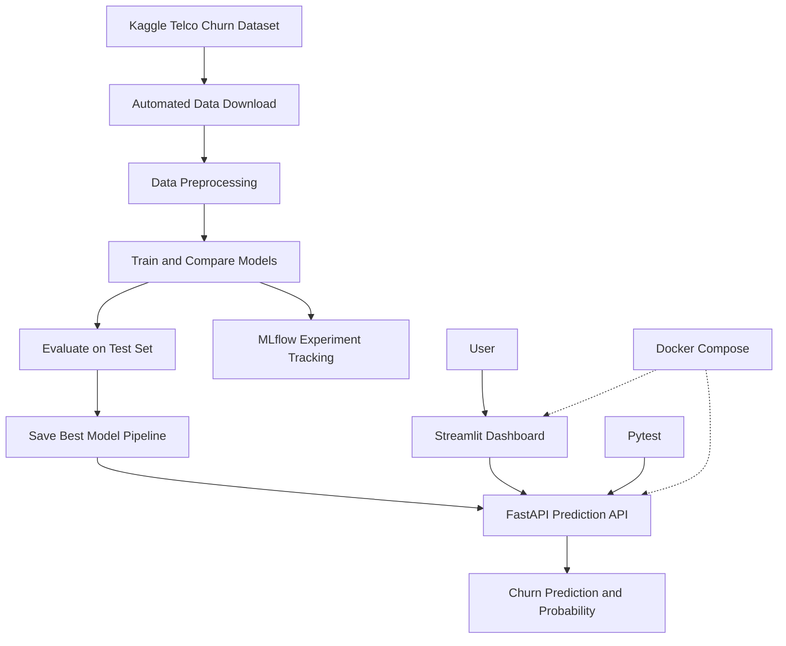

# End-to-End Customer Churn Prediction & MLOps Platform

An end-to-end machine learning and MLOps project that predicts customer churn using the Telco Customer Churn dataset. The platform combines automated data downloading, model training and evaluation, MLflow experiment tracking, a FastAPI prediction service, a Streamlit dashboard, automated testing, and Docker-based deployment.

## Project Overview

Customer churn occurs when customers stop using a company's services. Predicting potential churn can help businesses identify patterns in customer behavior and investigate opportunities to improve retention.

This project demonstrates the complete workflow of developing a machine learning model and making predictions accessible through an interactive web application.

### Key Features

- **Automated data downloading:** Downloads the dataset using a Python script.
- **Data preprocessing:** Handles missing values, numerical features, and categorical encoding through scikit-learn pipelines.
- **Model comparison:** Evaluates a baseline classifier, Logistic Regression, Random Forest, and XGBoost.
- **Model evaluation:** Compares models using ROC-AUC on held-out test data.
- **Experiment tracking:** Records experiments and metrics using MLflow with a SQLite backend.
- **REST API:** Serves churn predictions and probabilities using FastAPI.
- **Interactive dashboard:** Collects customer information and displays predictions using Streamlit.
- **Automated testing:** Tests API endpoints, input validation, and prediction responses using pytest.
- **Containerization:** Runs the API and dashboard as separate Docker Compose services.

## Architecture



## Technology Stack

| Area | Technologies |
|---|---|
| Programming language | Python 3.11 |
| Data processing | pandas, NumPy |
| Machine learning | scikit-learn, XGBoost |
| Experiment tracking | MLflow, SQLite |
| API | FastAPI, Uvicorn |
| Dashboard | Streamlit |
| Testing | pytest, HTTPX |
| Model persistence | joblib |
| Deployment | Docker, Docker Compose |
| Dataset source | Kaggle |

## Dataset

This project uses the [Telco Customer Churn dataset on Kaggle](https://www.kaggle.com/datasets/blastchar/telco-customer-churn).

The dataset includes customer demographics, subscribed services, contract information, billing details, and a churn label.

- **Target variable:** `Churn`
- **Positive class:** `Yes`
- **Negative class:** `No`
- **Customer identifier:** `customerID`, excluded from model features

The `TotalCharges` field is converted to a numeric representation. Missing numerical and categorical values are handled within the preprocessing pipeline.

### Dataset Setup

The dataset is downloaded automatically by the project's Python script and saved to `data/raw/` using the filename expected by the training pipeline.

From the project root, run:

```bash
python scripts/download_data.py
```

Before running the script:

1. Install the project dependencies as described below.
2. Configure Kaggle credentials if required by the download method implemented in the script.
3. Ensure your environment has access to the internet.

The script should create the required data directory if it does not already exist. The downloaded CSV is a local data artifact and does not need to be committed to GitHub.

## Installation and Setup

Clone your repository and navigate to the project directory:

```bash
git clone <YOUR_GITHUB_REPOSITORY_URL>
cd Customer-Churn
```

Create and activate a Python virtual environment.

**macOS/Linux:**

```bash
python3 -m venv .mlop_venv
source .mlop_venv/bin/activate
```

Install dependencies:

```bash
python -m pip install --upgrade pip
pip install -r requirements.txt
```

Download the dataset:

```bash
python scripts/download_data.py
```

Train and evaluate the models:

```bash
python scripts/train_models.py
```

Training produces the selected model artifact and evaluation reports. The model artifact is used by the API and Docker deployment.

## Model Training and Evaluation

The project compares four approaches:

- Dummy Classifier — baseline
- Logistic Regression
- Random Forest
- XGBoost

The preprocessing pipeline imputes missing values, scales numerical features where appropriate, and one-hot encodes categorical features. The data is split into training and test sets using a fixed random seed and stratification.

### Recorded Model Results

| Model | ROC-AUC |
|---|---:|
| XGBoost | 0.8438 |
| Logistic Regression | 0.8419 |
| Random Forest | 0.8349 |

XGBoost was selected as the best-performing non-baseline model in the recorded evaluation.

ROC-AUC measures how well a model ranks positive examples above negative examples across classification thresholds. These scores reflect the project's recorded held-out test evaluation and do not guarantee future performance.

Run training from the project root:

```bash
python scripts/train_models.py
```

Generated outputs include:

- `models/best_model.joblib`
- `reports/model_metrics.json`
- `reports/model_comparison.csv`
- `reports/best_model_summary.json`

## MLflow Experiment Tracking

MLflow tracks model experiments and evaluation metrics using a local SQLite database named `mlflow.db`.

After training, start the MLflow interface in a separate terminal from the project root:

```bash
python -m mlflow ui --backend-store-uri "sqlite:///$PWD/mlflow.db"
```

Open [http://127.0.0.1:5000](http://127.0.0.1:5000) to explore experiment runs and compare results.

The tracking database and experiment artifacts are local development outputs and should generally not be committed to GitHub.

## FastAPI Prediction Service

The FastAPI application provides the following endpoints:

| Method | Endpoint | Purpose |
|---|---|---|
| GET | `/` | API information |
| GET | `/health` | Health check and model status |
| POST | `/predict` | Predict churn for a customer |

Start the API locally:

```bash
python -m uvicorn src.api:app --reload
```

Open the interactive API documentation at [http://127.0.0.1:8000/docs](http://127.0.0.1:8000/docs).

Check the service health at [http://127.0.0.1:8000/health](http://127.0.0.1:8000/health).

A successful prediction returns a response similar to:

```json
{
  "churn_prediction": "Yes",
  "churn_probability": 0.7783,
  "no_churn_probability": 0.2217,
  "model": "best_model.joblib"
}
```

This is an illustrative example. Actual predictions depend on the submitted customer information and the trained model.

## Streamlit Dashboard

The Streamlit dashboard provides a form for entering customer attributes, including tenure, contract type, subscribed services, and billing details.

It sends the submitted information to the FastAPI service and displays the predicted churn class and estimated probability.

To run the dashboard locally, open a separate terminal, activate the same virtual environment, and run:

```bash
python -m streamlit run src/dashboard.py
```

Open [http://127.0.0.1:8501](http://127.0.0.1:8501).

When running through Docker Compose, the dashboard communicates with the API using the internal Docker service name.

## Automated Testing

The API test suite covers:

- Root endpoint response
- Health endpoint response
- Successful prediction
- Prediction probability consistency
- Invalid input categories
- Missing required fields
- Negative monthly charges
- Unexpected input fields

Run the tests from the project root:

```bash
python -m pytest tests/test_api.py -v
```

**Recorded test status:** 8 tests passed in the verified test run.

## Docker Deployment

Docker Compose runs the FastAPI service and Streamlit dashboard in separate containers.

Make sure Docker Desktop or another Docker Engine is running. The Docker deployment uses the saved model artifact, so ensure `models/best_model.joblib` exists before building the services.

Build and start the application:

```bash
docker compose up --build
```

Access the application:

- **Dashboard:** [http://127.0.0.1:8501](http://127.0.0.1:8501)
- **API documentation:** [http://127.0.0.1:8000/docs](http://127.0.0.1:8000/docs)
- **API health check:** [http://127.0.0.1:8000/health](http://127.0.0.1:8000/health)

Run the containers in the background:

```bash
docker compose up --build -d
```

View logs:

```bash
docker compose logs -f
```

Stop the application:

```bash
docker compose down
```

## Project Structure

```text
Customer-Churn/
├── data/
│   └── raw/                       # Downloaded dataset; not committed
├── models/
│   └── best_model.joblib          # Saved model pipeline
├── reports/
│   ├── model_metrics.json
│   ├── model_comparison.csv
│   └── best_model_summary.json
├── scripts/
│   ├── download_data.py
│   ├── train_models.py
│   ├── run_data_pipeline.py
│   └── test_prediction.py
├── src/
│   ├── __init__.py
│   ├── train.py
│   ├── api.py
│   └── dashboard.py
├── tests/
│   └── test_api.py
├── notebooks/
├── Dockerfile
├── Dockerfile.dashboard
├── docker-compose.yml
├── requirements.txt
├── .dockerignore
├── .gitignore
└── README.md
```

The MLflow database, experiment runs, downloaded dataset, and local virtual environment are generated or local development artifacts and should generally remain outside version control.

## Future Improvements

- Add continuous integration with GitHub Actions.
- Monitor prediction volume and incoming feature distributions.
- Detect data drift and evaluate performance when new labels become available.
- Add model versioning and reproducible training workflows.
- Improve API observability, logging, and error handling.
- Evaluate probability calibration and decision thresholds based on business requirements.

## Limitations and Responsible Use

This project is an educational demonstration using a public dataset. Predictions are estimates, not certain outcomes. Performance may change across populations, time periods, and business contexts.

Before using a system like this for real business decisions, validate it on appropriate data, assess potential bias, establish privacy and monitoring controls, and include appropriate human review.
